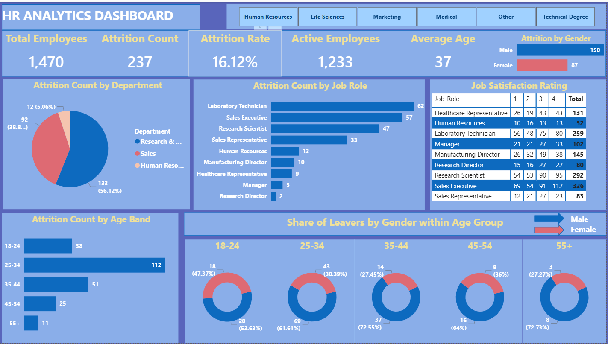

# HR Employee Attrition Analysis

## Project overview
This project explores employee attrition using SQL and an HR analytics dashboard. The analysis helps HR teams understand the scale of employee exits and examine how attrition varies across departments, job roles, age bands, gender, compensation, tenure, work arrangements, and employee survey measures.

## Repository structure

```
hr_employee_attrition/
├── data/
│   └── HR-Employee-Attrition.csv      # Raw source dataset
├── 01_schema.sql                      # Table creation and relationships
├── 02_Attrition Analysis.sql          # SQL analysis queries
├── 03_Dashboard.png                   # Dashboard snapshot
├── Attrition_Analysis_Report.pdf      # Written analysis report
└── README.md                          # Project overview and reproduction guide
```

| File | Purpose |
|---|---|
| `data/HR-Employee-Attrition.csv` | Original HR dataset (1,470 employee records) used as the source for the staging table |
| `01_schema.sql` | Splits the raw data into four normalized tables linked by `employee_id` |
| `02_Attrition Analysis.sql` | Queries covering headcount, attrition drivers, compensation, tenure, satisfaction, and rankings |
| `03_Dashboard.png` | Snapshot of the HR analytics dashboard |
| `Attrition_Analysis_Report.pdf` | Written report summarizing the findings |

Files are numbered in the order they should be used: schema first, then analysis, then dashboard.

## Tools and technologies
- **SQL / MySQL:** data preparation, relational table design, joins, aggregations, common table expressions (CTEs), conditional aggregation, and window functions.
- **Dashboarding tool:** the supplied dashboard image is consistent with a BI dashboard, but the specific application is not identified in the provided files.

## Data (`data/`)
`HR-Employee-Attrition.csv` is the source dataset. It is loaded into a staging table named `hr_attrition_raw`, which `01_schema.sql` reads from.

## Data model (`01_schema.sql`)
The schema script splits the source HR dataset into four tables linked by `employee_id`:

| Table | Main contents |
|---|---|
| `employees` | Employee demographics, education, distance from home, prior employers, total work experience, and attrition status |
| `job_details` | Department, job role and level, business travel, overtime, tenure, time in current role, promotion, and manager tenure |
| `compensation` | Monthly income, daily/hourly/monthly rates, salary-hike percentage, and stock-option level |
| `satisfaction_performance` | Environment, job, relationship and work-life satisfaction, job involvement, performance rating, and training frequency |

`employees.employee_id` is the primary key. The other three tables use `employee_id` as both their primary key and a foreign key referencing `employees(employee_id)`.

> **Warning:** the script drops the staging table (`hr_attrition_raw`) at the end. Keep the original CSV in `data/` (or a database backup) before running it in a new environment.

## SQL analyses (`02_Attrition Analysis.sql`)
The script contains queries for:
1. Overall headcount, leavers, stayers, and attrition percentage.
2. Attrition counts by department, job role, gender, and marital status.
3. Leavers by overtime and business-travel category.
4. Average monthly income, hourly rate, and salary-hike percentage for leavers versus stayers.
5. Attrition rates across monthly-income bands and stock-option levels.
6. Average income for leavers versus stayers by job level.
7. Attrition rates across tenure bands and early exits by department.
8. Average tenure, time in role, time with manager, and time since promotion by attrition status.
9. Survey-score comparisons and attrition rates by job satisfaction and work-life balance.
10. Attrition rates by training frequency and performance rating.
11. Ranking job roles within each department by attrition rate.

## Dashboard (`03_Dashboard.png`)
The dashboard presents headline workforce KPIs and breakdowns of attrition by department, job role, age band, and gender. It also includes a job-satisfaction table and a gender split among leavers within each age group.



### Headline results
- **Total employees:** 1,470
- **Employees who left:** 237
- **Employees remaining:** 1,233
- **Overall attrition rate:** 16.12%
- **Average age:** 37
- **Leavers by gender:** 150 male and 87 female

These are the values displayed in the dashboard. Counts describe the number of leavers; they should not be interpreted as attrition *rates* unless the relevant group headcount is also considered.

## Report (`Attrition_Analysis_Report.pdf`)
The PDF report documents the written analysis and findings that accompany the SQL queries and dashboard.

## How to reproduce
1. Install or open a MySQL-compatible database environment.
2. Load `data/HR-Employee-Attrition.csv` into a staging table named `hr_attrition_raw` (adapt the import or table name if needed).
3. Review the column names in `01_schema.sql`; the script expects the source columns shown there.
4. Run `01_schema.sql` to create the normalized tables and relationships. **Back up the raw table first**, as the script drops `hr_attrition_raw` at the end.
5. Run `02_Attrition Analysis.sql` query by query and inspect the result sets.
6. Recreate the dashboard from the query outputs, or connect a BI tool to the tables and build the visuals shown in `03_Dashboard.png`.
7. Read `Attrition_Analysis_Report.pdf` for the written interpretation.
